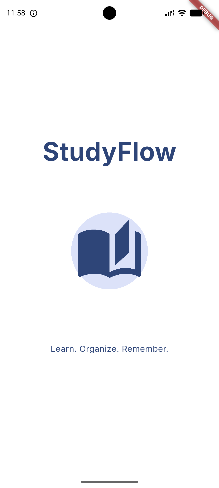
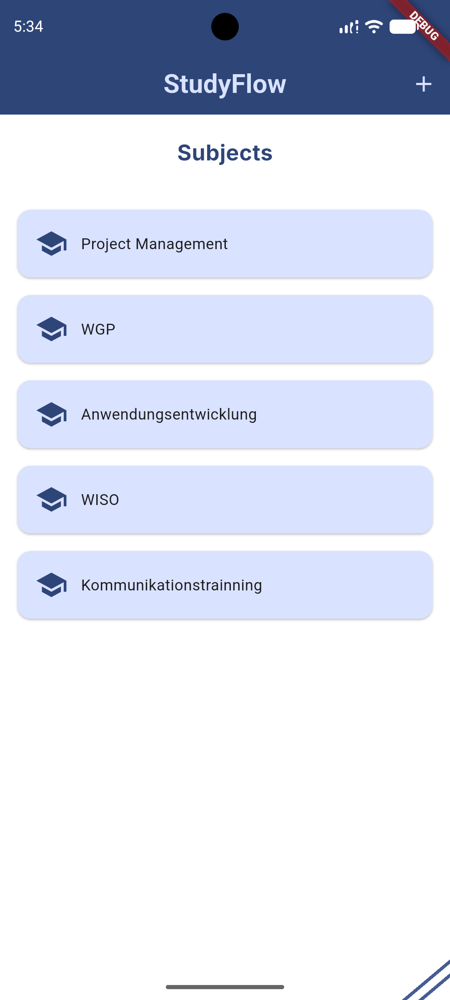
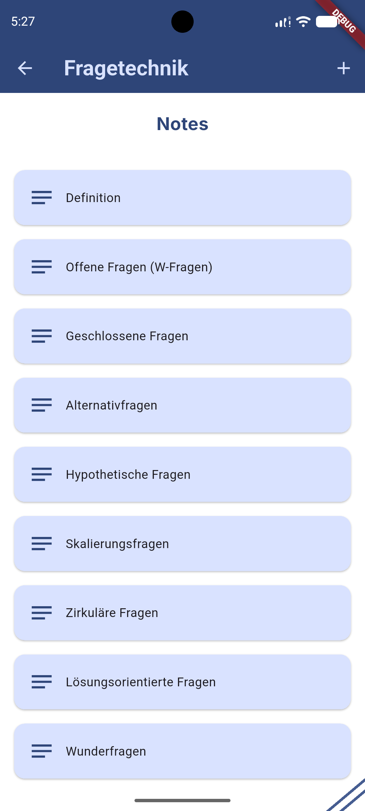
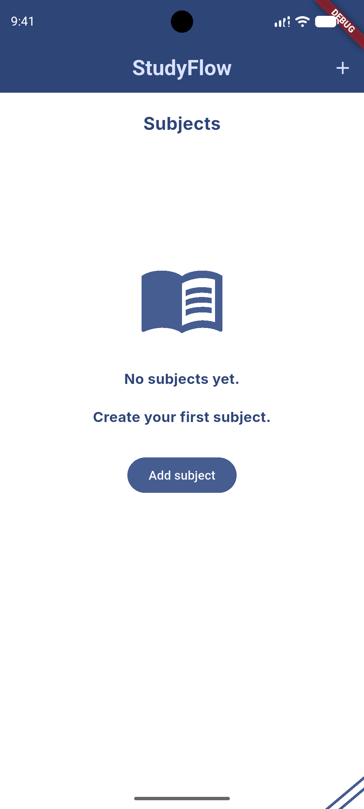
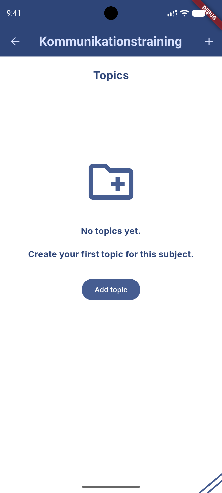
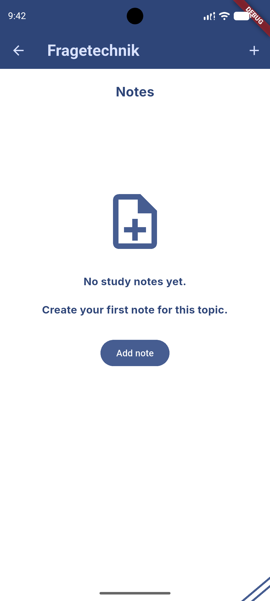

# StudyFlow Frontend

This folder contains the Flutter frontend for StudyFlow.

The current frontend is an offline-first Flutter application under active development. It uses repository contracts with ToStore-backed local persistence and is not connected to the ASP.NET Core backend yet.

The app uses Riverpod providers and controllers for its local-first study, quiz, and exam preparation flows. Riverpod handles asynchronous access to local entities, quiz validation, quiz play data loading, and JSON seed import. The UI includes a usable Study Mode, the first functional Exam Mode screens, Markdown explanations, responsive layouts, light/dark themes, and a custom launcher icon.

## English

## Current Features

- Start screen before entering the main StudyFlow flow
- Mode selection screen with functional Study Mode and Exam Mode entry points
- View, create, edit, and delete subjects locally
- View, create, edit, and delete topics locally
- Open topics in a dedicated topic detail screen
- Switch between notes and quiz area with a bottom navigation bar
- View, create, edit, and delete study notes locally
- Open a study note and read Markdown-rendered content
- Create quizzes locally
- View, create, edit, and delete quiz questions locally
- View, create, edit, and delete answer options locally
- Mark answer options as correct
- Validate quiz readiness before starting
- Start a quiz and answer questions
- Randomize quiz questions and answer options during quiz play
- Render quiz questions and answer options as Markdown
- Show visual feedback for correct and incorrect quiz answers
- Show optional Markdown explanations after answering quiz questions
- View final quiz results with score, percentage, and retry option
- Use quizzes without a fixed maximum question count
- Create, edit, and delete exam sections such as AP1 or AP2
- Open an exam section with Tips, Exams, and History tabs
- Create, edit, delete, and read Markdown-formatted exam tips locally
- Import structured content from pasted JSON or a selected `.json` file
- Import subjects, topics, notes, quizzes, exam sections, and exam tips
- Import optional quiz question explanations while remaining compatible with older seeds
- Reuse existing subjects, topics, and exam sections during JSON seed import
- ToStore-backed local persistence for Study Mode and the current Exam Mode entities
- Cascade deletion support through ToStore relationships
- Repository contracts for local-first data access
- Riverpod migration for the main local-first study and quiz flows
- Stream-based Riverpod providers for automatic UI updates in migrated local lists
- Riverpod controllers for create/edit/delete actions
- Application-level helpers for quiz validation, quiz play data loading, and JSON seed import
- String-based IDs prepared for ToStore and backend integration
- Basic Material Design UI
- Custom light and dark color schemes
- Responsive layouts for phones and tablets in portrait and landscape
- Custom StudyFlow launcher icon for Android, iOS, and Windows
- Reusable mode card, list item, form button, SnackBar, and empty state widgets
- Themed SnackBar feedback for local success, info, error, and delete actions
- Practice Exam models, relationships, repository contracts, ToStore schemas, and the first ToStore repository

## Screenshots

Current work-in-progress Flutter UI using local-first ToStore persistence.

<p>
  
  
  
  
  
</p>

## Empty States

Screens shown when there is no local data yet.

<p>
  
  
  
</p>

## App Flow

```text
StartScreen
-> ModeSelectionScreen
   -> Study Mode
      -> SubjectsScreen
         -> TopicsScreen
            -> TopicDetailScreen
               -> StudyNotesScreen
                  -> NoteScreen
               -> QuizzesScreen
                  -> QuizQuestionsScreen
                     -> QuestionDetailScreen
                  -> QuizPlayScreen
                     -> QuizResultScreen
   -> Exam Mode
      -> ExamSectionsScreen
         -> ExamSectionDetailScreen
            -> ExamTipsScreen
               -> ExamTipScreen
            -> Practice Exams (planned)
            -> History (planned)
```

## Project Structure

```text
frontend/
|-- docs/
|   |-- architecture/
|   `-- screenshots/
|-- lib/
|   |-- application/
|   |   |-- import/
|   |   |   |-- import_study_seed.dart
|   |   |   |-- study_seed.dart
|   |   |   |-- study_seed_parser.dart
|   |   |   `-- study_seed_validation.dart
|   |   `-- quiz/
|   |       |-- load_quiz_play_data.dart
|   |       |-- quiz_play_data.dart
|   |       `-- validate_quiz_can_start.dart
|   |-- controllers/
|   |   |-- exam_sections_controller.dart
|   |   |-- exam_tips_controller.dart
|   |   |-- subjects_controller.dart
|   |   |-- topics_controller.dart
|   |   |-- study_notes_controller.dart
|   |   |-- quizzes_controller.dart
|   |   |-- questions_controller.dart
|   |   `-- answer_options_controller.dart
|   |-- local/
|   |   `-- tostore/
|   |       |-- studyflow_database.dart
|   |       |-- studyflow_schemas.dart
|   |       |-- tostore_exam_sections_repository.dart
|   |       |-- tostore_exam_tips_repository.dart
|   |       |-- tostore_subjects_repository.dart
|   |       |-- tostore_topics_repository.dart
|   |       |-- tostore_study_notes_repository.dart
|   |       |-- tostore_quizzes_repository.dart
|   |       |-- tostore_questions_repository.dart
|   |       `-- tostore_answer_options_repository.dart
|   |-- models/
|   |   |-- exam_section.dart
|   |   |-- exam_tip.dart
|   |   |-- subject.dart
|   |   |-- topic.dart
|   |   |-- study_note.dart
|   |   |-- quiz.dart
|   |   |-- question.dart
|   |   |-- answer_option.dart
|   |   |-- practice_exam.dart
|   |   |-- practice_exam_question.dart
|   |   `-- practice_exam_answer_option.dart
|   |-- providers/
|   |   |-- answer_options_repository_provider.dart
|   |   |-- answer_options_stream_provider.dart
|   |   |-- exam_sections_repository_provider.dart
|   |   |-- exam_sections_stream_provider.dart
|   |   |-- exam_tips_repository_provider.dart
|   |   |-- exam_tips_stream_provider.dart
|   |   |-- import_study_seed_provider.dart
|   |   |-- load_quiz_play_data_provider.dart
|   |   |-- questions_repository_provider.dart
|   |   |-- questions_stream_provider.dart
|   |   |-- quizzes_repository_provider.dart
|   |   |-- quizzes_stream_provider.dart
|   |   |-- study_notes_repository_provider.dart
|   |   |-- study_notes_stream_provider.dart
|   |   |-- subjects_repository_provider.dart
|   |   |-- subjects_stream_provider.dart
|   |   |-- topics_repository_provider.dart
|   |   |-- topics_stream_provider.dart
|   |   `-- validate_quiz_can_start_provider.dart
|   |-- repositories/
|   |   `-- contracts/
|   |-- screens/
|   |-- theme/
|   `-- widgets/
|-- pubspec.yaml
`-- README.md
```

## Tech Stack

- Dart
- Flutter
- Material Design
- ToStore for local persistence
- Repository pattern with local ToStore implementations
- Riverpod for state management, dependency access, and controller-based screen logic
- StreamProvider for automatic UI updates in migrated local lists
- flutter_markdown for rendering study notes, quiz questions, and answer options
- file_selector for importing JSON files through the platform file picker
- StatefulWidget and setState for purely local visual UI state
- Flutter Navigator for screen navigation

## Run Locally

Install dependencies:

```powershell
flutter pub get
```

Analyze the project:

```powershell
flutter analyze
```

Run the app:

```powershell
flutter run
```

## JSON Seed Import

StudyFlow accepts pasted JSON and `.json` files. A seed can contain Study Mode
content, optional quiz question explanations, Exam Mode sections, or a
combination of them. Existing subjects, topics, and exam sections are reused
when their normalized names match.

- [JSON seed format](docs/json-seed-template.md)
- [Exam Mode seed example](docs/exam-seed-example.json)

Study notes, quizzes, questions, answer options, and exam tips are added as new
content when a seed is imported again. Import tests cover questions with and
without explanations. Import rollback and Practice Exam import are not
implemented yet.

# Current Status

The frontend is intentionally local-first at this stage.

Screens access data through repository contracts, and the active implementations use ToStore for local persistence. Subjects, topics, study notes, quizzes, questions, and answer options are stored locally.

Subjects, topics, study notes, quizzes, questions, answer options, quiz validation, and quiz play data loading have been migrated to Riverpod-based providers, controllers, and application-level helpers. Subjects, topics, study notes, quizzes, quiz questions, and answer options now use stream-based providers backed by ToStore watchers, so their lists update automatically when local data changes. Controllers delegate persistence operations to the ToStore-backed repositories, while screens observe provider state and forward user actions to controllers instead of loading and storing entity lists manually.

The app now supports local create, edit, and delete flows for the main study entities: subjects, topics, study notes, quiz questions, and answer options. Larger deletion flows, such as subjects and topics, use confirmation dialogs because related data can be removed through ToStore cascade relationships.

The quiz area has a usable local flow. Users can create quiz questions, add answer options, mark correct answers, prevent multiple correct answers for the same question, edit quiz content, validate quiz readiness before starting, play quizzes of any length with randomized questions and answer options, receive visual feedback, read optional Markdown explanations, and view a final result screen with score and percentage.

Study notes, quiz questions, answer options, and question explanations are rendered as Markdown when shown to the user. This keeps generated JSON seed content readable when it includes bullets, emphasis, explanations, or simple structured text.

The UI has a dedicated mode selection screen after the start screen. Study Mode opens the subject/topic/note/quiz flow. Exam Mode opens locally persisted exam sections and provides a section detail screen with Tips, Exams, and History destinations. Tips are functional and support Markdown. The Practice Exam foundation now contains its models, relationships, repository contracts, ToStore schemas, and top-level ToStore repository. Question and answer repositories, screens, simulation, and History remain under development. JSON seed import is available from the mode selection area.

Light and dark themes are configured in `lib/theme/app_theme.dart`. Shared UI helpers keep repeated styling consistent, including mode cards, primary form button styling, and success/info/error/delete SnackBars.

The JSON seed import flow accepts pasted JSON and `.json` files through the platform file selector. It can create Study Mode content, optional quiz explanations, exam sections, and exam tips. Existing subjects, topics, and exam sections are reused by normalized name comparison. The importer validates the seed and retries local creation operations to tolerate temporary ToStore ID-pool delays. Focused tests verify compatibility with questions both with and without explanations.

The frontend models use string-based IDs to prepare the app for local persistence and later backend synchronization.

The next major work is completing the remaining Practice Exam repositories and management screens, simulation, persisted attempts, and a useful history view.

## Next Steps

- Implement the remaining ToStore repositories for Practice Exam questions and answers
- Add providers, controllers, management screens, and validation
- Add Practice Exam simulation with Markdown explanations
- Persist exam attempts and show basic result history
- Extend JSON seeds with Practice Exams and answer explanations
- Add focused tests for Practice Exam persistence and validation
- Complete release testing on phone and tablet
- Add JSON export, backend integration, and synchronization after V1

---

## Deutsch

### Aktuelle Funktionen

- Offline-first Study Mode mit Subjects, Topics und Markdown Study Notes
- Lokales Erstellen, Bearbeiten und Loeschen von Lerninhalten
- Quizze mit beliebig vielen Fragen und zufaelliger Reihenfolge
- Markdown fuer Fragen, Antwortoptionen und optionale Erklaerungen
- Visuelles Feedback sowie Ergebnisanzeige mit Punktzahl und Prozentwert
- Exam Sections fuer Bereiche wie AP1 und AP2
- Lokal persistierte Exam Tips mit Markdown-Unterstuetzung
- JSON-Import ueber Text oder Dateiauswahl
- Import von Quiz-Erklaerungen mit Kompatibilitaet zu aelteren Seeds
- ToStore-Persistenz mit Foreign Keys und Cascade Delete
- Riverpod-Provider, StreamProvider und Controller fuer lokale Flows
- Responsive Layouts fuer Smartphone und Tablet in Hoch- und Querformat
- Gemeinsames Light Theme und Dark Theme
- Eigenes StudyFlow-App-Icon fuer Android, iOS und Windows
- Practice-Exam-Modelle, Repository-Vertraege, ToStore-Schemas und das erste ToStore-Repository

### App-Ablauf

```text
StartScreen
-> ModeSelectionScreen
   -> Study Mode
      -> Subjects -> Topics -> Notes oder Quiz
   -> Exam Mode
      -> Exam Sections
         -> Tips (nutzbar)
         -> Practice Exams (in Entwicklung)
         -> History (geplant)
```

### Aktueller Stand

Das Frontend funktioniert ohne Backend und speichert seine Daten lokal mit
ToStore. Die Screens greifen ueber Repository-Vertraege auf Daten zu. Riverpod
stellt Repositories, Live-Listen und Controller bereit, sodass die UI nicht
direkt von der Persistenzimplementierung abhaengt.

Study Mode ist bereits als nutzbarer Offline-Flow vorhanden. Quizfragen koennen
optionale Markdown-Erklaerungen enthalten, die nach der Beantwortung angezeigt
werden. Der JSON-Importer verarbeitet Fragen mit und ohne Erklaerung; gezielte
Tests pruefen beide Varianten.

Exam Mode unterstuetzt aktuell Exam Sections und Markdown Tips. Fuer Practice
Exams existieren bereits `PracticeExam`, `PracticeExamQuestion` und
`PracticeExamAnswerOption` sowie Beziehungen, Cascade-Regeln,
Repository-Vertraege und ToStore-Schemas. Das ToStore-Repository fuer
Practice Exams ist implementiert. Repositories fuer Fragen und Antworten, UI,
Simulation und Versuchshistorie sind noch nicht als fertige Funktion verfuegbar.

### Naechste Schritte

- ToStore-Repositories fuer Practice-Exam-Fragen und -Antworten
- Provider, Controller und CRUD-Screens
- Validierung: mindestens vier Optionen und genau eine richtige Antwort
- Exam-Simulation mit Erklaerungen und Ergebnisanzeige
- Persistierte Versuche und History
- Practice Exams im JSON-Import
- Tests und Release-Pruefung auf Smartphone und Tablet

### Lokal ausfuehren

```powershell
flutter pub get
flutter analyze
flutter run
```
